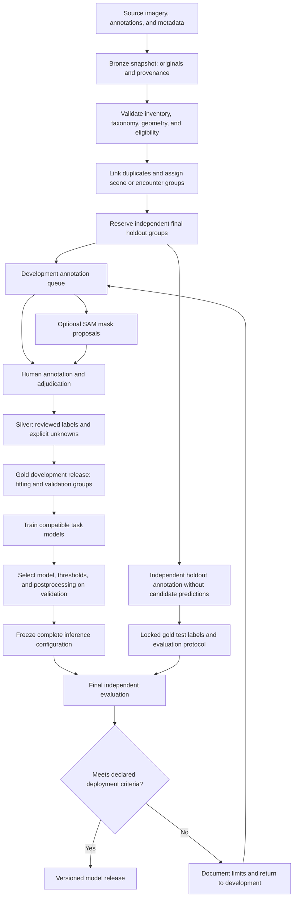
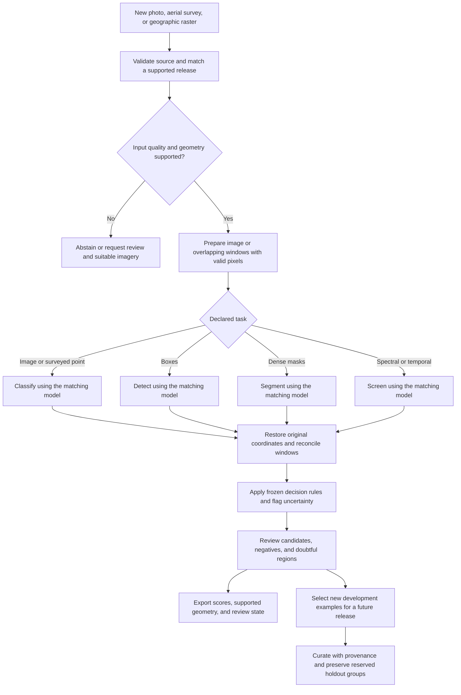

# Ideal weed detection pipeline

Draft, 13 November 2026. This is the target architecture and implementation order,
not a description of completed functionality. See [datasets.md](datasets.md) for
source contents, licences, and the processing route for each collection.

## Are we using SAM today?

**No. We do not currently use SAM or any other segmentation model.**
[model.py](../src/weedz/model.py) fits class-balanced logistic regression on 84
handcrafted colour/texture features from 39×39 Leafy Spurge survey crops. It
predicts presence at sampled locations and exports points. There are no masks,
learned image encoders, general raster inference, or installed SAM dependencies.
The working baseline remains available through `uv run main.py`.

The proposed approach is to use **SAM-assisted annotation plus a supervised
species segmentation model**. SAM assistance is optional; the pipeline must also
accept existing masks and fully manual annotations. A mask boundary, species
identity, and geographic accuracy are separate claims with separate evidence.

## Model roles and initial choices

These are starting experiments, not validated model selections for our domain.
Pin model/checkpoint revisions, input configuration, and preprocessing with each
experiment; adopting a model does not establish NZ field performance.

| Role | Proposed starting point | What it supplies | What still needs validation |
| --- | --- | --- | --- |
| Cheap regression baseline | Existing colour/texture logistic classifier | Reproducible point-level reference | Limited to the existing crop protocol |
| Interactive annotation | SAM 2.1 with reviewer point/box prompts | Candidate object/patch boundaries for a reviewer to correct | Species identity, completeness, edge quality, and whether annotation time improves |
| Concept-based proposal experiment | SAM 3 with text or visual exemplars | Candidate detections/masks matching a prompted concept | Botanical accuracy, confusing taxa, missed small plants, compute, and checkpoint eligibility |
| Ground-photo identification | Pretrained RGB image encoder with a species-classification head | Taxon scores for curated iNaturalist/DeepWeeds images | Transfer across observers, habitats, views, growth stages, and unfamiliar species |
| Dense aerial segmentation | A small U-Net trained on reviewed masks | Per-pixel scores for the dataset's declared species/classes | Patch recall, boundaries, physical scale, site/season transfer, and inference cost |
| Box detection | A supervised detector trained on reviewed boxes | Candidate locations and species scores | Small-object recall and annotation completeness; boxes do not define silhouettes |
| Spectral/temporal screening | A separate model with explicit band/time inputs | Broad regional candidates or change scores | Independent labels at matching spatial/temporal support |

[SAM 2](https://github.com/facebookresearch/sam2) provides prompted image masks,
automatic mask generation, and video propagation; its repository includes the
SAM 2.1 checkpoints. Start with point/box assistance on representative images,
then measure saved review time and correction burden. Its code/checkpoint
licensing is documented in the [official repository](https://github.com/facebookresearch/sam2#license).

[SAM 3](https://github.com/facebookresearch/sam3) adds text/exemplar concept
segmentation. It is a useful candidate to benchmark, but a prompt such as
"gorse" is not a verified botanical label. It has its own
[SAM licence](https://github.com/facebookresearch/sam3/blob/main/LICENSE)
and checkpoint access process; do not assume SAM 2's terms apply. No model access
or checkpoint download is part of this draft.

[U-Net](https://lmb.informatik.uni-freiburg.de/people/ronneber/u-net/) is the
initial supervised architecture to benchmark for dense masks. Train or fine-tune
it with task-compatible reviewed labels, including explicit background and ignored
regions. Compare stronger encoder/decoder variants only when validation justifies
the extra cost. Choose the exact implementation and any pretrained weights with
their own provenance; citing an architecture is not a licence for arbitrary weights.

SAM's mask-quality output must not be presented as species confidence. Even a
visually precise mask may outline the wrong plant, one leaf, several interwoven
species, or only part of a patch. Keep these failures visible during review.

## Flow 1: build data and release a model

All nodes below are proposed. The test branch is independently annotated and
remains outside training, active learning, prompt tuning, and model selection.

If final test results guide another development round, that test is no longer a
fresh independent release gate. Record its new role and obtain an unseen final
holdout before another generalisation claim. Do not relabel it into training.

### 1. Acquire and preserve bronze

Use source adapters for Leafy Spurge, iNaturalist, MAVSD, geographic imagery,
box datasets, and occurrence tables. Preserve original media/labels, source IDs,
queries/releases, retrieval dates, licence/attribution evidence, and SHA-256 hashes.
Derived crops, normalised labels, and proposed masks never overwrite originals.
Record unavailable or ineligible assets rather than silently dropping them.

### 2. Build the inventory and reserve groups

Normalise source records into the common contract in [datasets.md](datasets.md).
Require task/supervision type, original and mapped taxon, source/parent IDs,
image dimensions/bands, annotation extent, and review state. Geography, pose,
GSD, and precise coordinates may be unknown; do not invent them.

Link duplicates across sources. Group parent rasters and tiles, video/flight
frames, stereo pairs, all photos from one observation, and known repeated plant
encounters. Reserve sites, surveys, observers, or time periods before generating
derivatives. Keep partition manifests stable across annotation and training runs.
Set buffers from actual footprints and coordinate uncertainty, not the legacy
baseline's fixed 2 m rule.

### 3. Review species identity and geometry

Route by available evidence. Image labels remain image labels; surveyed points
remain local observations. Use a reviewer-confirmed plant or region to prompt
SAM on sufficiently detailed imagery. Store prompts, model/checkpoint, proposed
mask, and reviewer corrections separately. Retain existing valid masks directly.
Do not enlarge a tiny crop and treat the extra pixels as new botanical evidence.

A reviewer confirms the taxon, corrects the boundary, records uncertain regions,
and accepts/rejects the candidate. Crowded patches may need multiple masks,
manual boundaries, or an unknown region. A missed candidate needs an explicit
manual-add path. Track reviewer time and a random audit sample as well as model
disagreements, so a queue of obvious errors does not bias the quality estimate.

Holdout labels are created independently of the model/proposals being evaluated,
with expert adjudication for ambiguous cases. Model-assisted labels in fitting
data retain their origin; they are not independent evidence of accuracy.
For existing benchmark masks, audit annotation provenance. A comparison of SAM
proposal quality needs an independently reviewed reference subset rather than
assuming that model-assisted source boundaries are independent ground truth.

### 4. Freeze gold and train according to supervision

Create a reproducible release with exact samples, accepted annotations, ignored
regions, taxonomy mapping, source rights, and fitting/validation/test groups.
Version preprocessing, augmentations, sampling, model configuration, and seeds.
Reject incompatible sample/task combinations instead of silently weakening labels.

| Evidence and sources | Training path | Valid prediction |
| --- | --- | --- |
| Surveyed points: Leafy Spurge | Existing local-crop classification; later explicitly specified point supervision | Point/local-crop presence score |
| Species images/photo sets: iNaturalist, DeepWeeds | Species-classification head; declare any observation aggregation | Image/observation taxon scores and abstention |
| Dense masks: MAVSD, reviewed LINZ/drone imagery | Supervised semantic segmentation; preserve source classes and ignored pixels | Image-space class score maps and masks |
| Boxes: ImageWeeds, eligible OpenWeeds annotations | Box detector with correct class/coordinate conventions | Species boxes and scores |
| Sparse masks: eligible OpenWeeds annotations | Loss/metrics only on annotated pixels | Mask predictions whose unreviewed extent remains unverified |
| Occurrences: DOC | Site selection and survey prioritisation | Candidate survey areas; no direct vision supervision |
| Unlabelled RGB/NIR rasters or Sentinel-2 | Inference, annotation acquisition, or separately evaluated representation learning | Review candidates; reference labels are still needed for accuracy |

Share reusable infrastructure and, where validated, learned representations.
Keep classification, dense masks, boxes, and multispectral inputs explicit. A
classifier trained on ground gorse photos does not automatically become an aerial
gorse segmenter. MAVSD goldenrod masks cannot establish NZ gorse performance.

### 5. Validate and release the complete inference configuration

Measure same-species transfer across viewpoints, resolutions, sites, and seasons.
Use IoU/Dice, species precision/recall, and patch misses for segmentation; report
appropriate classification and detection metrics for their own tasks. Break down
misses by small plants, non-flowering stages, occlusion, lookalikes, and habitat.
Report independent group counts, uncertainty, annotation effort, and compute cost.

Choose operating thresholds, any calibration, tile overlap, minimum patch size,
and optional SAM refinement using development data only. Compare the full
runtime route; proposal or refinement stages can introduce missed detections.
Calibrated scores on a familiar domain do not prove correctness on unfamiliar data.

A release pins the model weights/hash, dataset release, label mapping, permitted
input views/bands/GSD range, preprocessing, thresholds, postprocessing, and measured
limitations. Define acceptable missed-patch rate, false alarms, review workload,
and runtime for a particular deployment before final evaluation. Exact values
need field requirements and representative data; this draft does not invent a
universal accuracy target. A failed configuration stays an experiment.

## Flow 2: run detection on new imagery

### Prepare the input at its real scale

For ordinary photos, honour available orientation metadata, preserve aspect
ratio, and retain the inverse resize/padding transform. For orthomosaics, read
windows while preserving parent ID, CRS, affine transform, pixel validity, bands,
and GSD. Choose the physical footprint supported by the model and process the
image at that scale. Do not treat a 256-pixel phone image and a 256-pixel satellite
tile as equivalent observations.

For raw drone/oblique frames, retain calibration and camera pose where supplied.
An image-space mask is a useful output without ground geometry. Accurate ground
mapping requires existing orthorectification or a validated camera/terrain
projection, including surface/plant height where it affects the result.
A perspective warp alone cannot remove 3D plant occlusion.

### Infer, reconcile, and optionally refine

Dense aerial inference uses overlapping windows, blends class scores over valid
pixels, and thresholds after reconciling the mosaic. Record all inverse transforms
to original image space. Apply tested patch/edge rules and check that filtering
does not erase the small infestations we need to find.

The normal dense-segmentation path can run without SAM. An optional alternative
is a species detector supplying boxes to SAM 2.1 for boundary refinement, or a
SAM 3 proposal route followed by species verification. Each alternative needs
its own end-to-end test, including the recall of its candidate stage. Automatic
mask generation is not a completeness guarantee, and running all tiles through
SAM is not a prerequisite for the first useful system.

For video, propagation can reduce annotation effort but repeated frames remain
one encounter group. Add a runtime video tracker only after a video-specific
evaluation exists; current source data do not establish tracking performance.

### Review and export only supported claims

Show the original imagery, candidate taxon, score meaning, mask/box, model release,
source/GSD/date, and label/review evidence. Keep class score, mask-quality estimate,
and geographic uncertainty distinguishable. Preserve unknown/nodata regions;
missing detections are not evidence that an unreviewed area is weed-free.

Export pixel masks/boxes for photos and oblique images without ground geometry.
Export georeferenced score rasters and GeoJSON/GeoPackage review polygons only
when the geometry supports them. Calculate hectares in a suitable metric CRS.
False alarms per hectare require exhaustively reviewed representative areas;
sampled points cannot provide that measurement. An iNaturalist observation
location is not the footprint of the organism in its photo.

Review feedback creates new development examples with provenance. Audit some
predicted negatives and uncertain areas as well as high-score candidates to
find missed infestations. Never silently retrain on the final holdout or
overwrite accepted originals. Model updates produce a new frozen release.

## Pragmatic implementation sequence

This sequence prioritises the first working segmentation path. MAVSD already
supplies masks, so that experiment need not wait for SAM integration. The bounded
iNaturalist classification experiment in [datasets.md](datasets.md) can follow
the shared inventory independently; its image labels do not train the mask head.

| Slice | Concrete result | Acceptance evidence |
| --- | --- | --- |
| 1. Shared inventory and review | Typed dataset adapters, grouping, append-only decisions, and release manifests; retain the existing baseline | Rebuild identical sample lists; enforce supervision/rights/geometry rules and split separation |
| 2. Small segmentation baseline | Train a U-Net on a bounded, scene-grouped MAVSD subset with existing masks | Aligned image/mask transforms, ignored-pixel handling, angle-specific validation, and an honest independent test |
| 3. Annotation assistance | Add SAM 2.1 to a review queue for eligible development images; benchmark SAM 3 proposals if useful | Corrected masks, evidence of species identity, saved reviewer time, correction burden, and independent audit |
| 4. Local collection and transfer | Build NZ target/negative labels with suitable LINZ/drone imagery; use iNaturalist for a separate classification task | Same-species/view/scale coverage and an independent local field holdout |
| 5. Geographic inference | Windowed inference, score merging, raster/polygon export, and abstention | Spatial round-trip checks, small-patch recall, and measured cost/review load |
| 6. Release and feedback | Frozen inference bundle, repeatable evaluation, and versioned corrections | Deployment-specific acceptance criteria met without test-driven tuning |

Begin local field collection alongside slices 1–3, because new independent sites
and seasonal coverage take time. Run annotation/training jobs on optional GPU
workers when needed; keep source acquisition, manifests, and reports usable
without a GPU. Cache expensive image embeddings by input checksum, image/window
transform, model hash, and preprocessing version. Start with local files and
bounded jobs; separate these stages logically before adding deployment infrastructure.

For implementation, use failing tests for task routing, joint image/mask geometry,
ignored pixels, duplicate grouping, model/prompt provenance, score semantics,
tile reconciliation, and geographic transforms. This document changes no model,
dependencies, or CLI behavior. Dataset-specific details remain in
[datasets.md](datasets.md).
