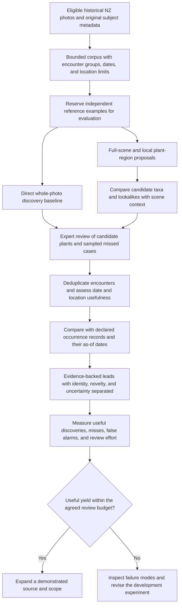
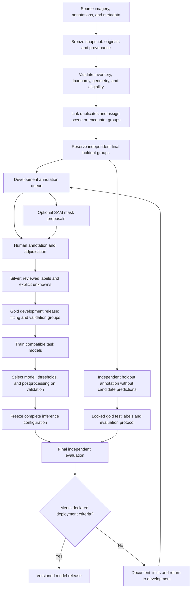
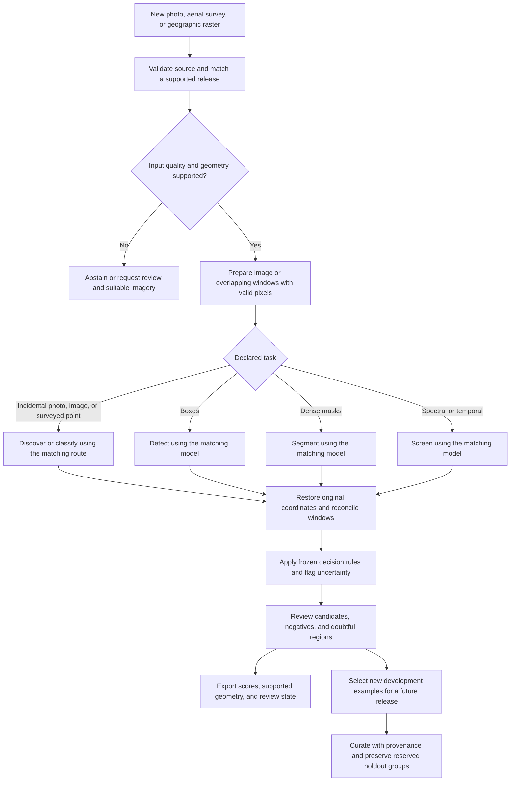

# Ideal weed detection pipeline

Draft, 13 November 2026. Most of this is the target architecture; the implemented
regional screening path is described below. See [datasets.md](datasets.md) for
source contents, licences, and the processing route for each collection.

Weedz is an **open-source, non-commercial project for public good**. The design
supports openly shared methods and conservation research, with attribution and
source-specific terms retained for imagery, annotations, and model assets.

The updated product brief prioritises **incidental plants in photographs taken
for another purpose**. The first experiment is inference and expert review on a
bounded historical NZ collection. Demonstrating useful discoveries comes before
building a general supervised segmentation service. Aerial segmentation and
labelled species datasets remain supporting research paths.

## Are we using SAM today?

**No. We do not currently use SAM or any other segmentation model.** The regional
pilot now uses pinned **BioCLIP ViT-B/16** embeddings on CPU for screening, with
Temporal activities for acquisition, inference and export, and Next.js for review.
Each image contributes a letterboxed whole frame and overlapping square tiles
that cover every pixel. Targets and
lookalikes are compared using image/text cosine similarity; no calibrated
probabilities, species boundaries or novel locality claims are produced.
See [the operating guide](local-development.md) for the implemented path and limits.

The separate supporting baseline in
[model.py](../src/weedz/model.py) fits class-balanced logistic regression on 84
handcrafted colour/texture features from 39×39 Leafy Spurge survey crops. It
predicts presence at sampled locations and exports points. That baseline has no
segmentation masks, general raster inference or installed SAM dependencies.
The working baseline remains available through `uv run main.py`.

The first proposed comparison is **direct whole-photo analysis versus candidate
regions followed by specialist identification and expert review**. Segmentation
may help isolate incidental plants or annotate evidence, but is not a prerequisite
for testing discovery value. Add source-eligible supervised training only when
the observed failures justify it. A mask boundary, species identity, and
geographic accuracy remain separate claims with separate evidence.

## Model roles and initial choices

These are starting experiments, not validated model selections for our domain.
Pin model/checkpoint revisions, input configuration, and preprocessing with each
experiment; adopting a model does not establish NZ field performance.

| Role | Proposed starting point | What it supplies | What still needs validation |
| --- | --- | --- | --- |
| Cheap regression baseline | Existing colour/texture logistic classifier | Reproducible point-level reference | Limited to the existing crop protocol |
| Direct discovery baseline | Existing eligible multimodal image model examining the full photo against the watchlist | Candidate secondary plants, supporting regions, and inconclusive cases | Small/background-plant recall, invented details, lookalikes, and end-to-end review effort |
| Candidate-region discovery | SAM 3-family concept/geometric proposals with full-scene and local context | Plant regions to identify and review | Proposal-stage misses and whether region analysis improves on the direct baseline |
| Interactive annotation | Compare SAM 3-family visual prompting with SAM 2.1 point/box assistance | Candidate object/patch boundaries for a reviewer to correct | Species identity, completeness, edge quality, and whether annotation time improves |
| Concept-based proposal experiment | SAM 3-family still-image pipeline with text or visual exemplars; pin its actual checkpoint | Candidate detections/masks matching a prompted concept | Botanical accuracy, confusing taxa, missed small plants, compute, and checkpoint eligibility |
| Video segmentation/tracking experiment | SAM 3.1 Object Multiplex when video is introduced | Joint tracking and segmentation of multiple prompted objects | End-to-end weed recall, temporal stability, peak memory, throughput, and hardware dependence |
| Candidate plant identification | Benchmark existing BioCLIP 2/2.5 representations and contextual visual reasoning; later task-specific heads only on eligible data | Candidate taxon comparisons against lookalikes, with original-scene context | Background-plant identifiability, unknown species, plausible wrong matches, and source-use eligibility |
| Supporting dense aerial segmentation | A small U-Net trained on eligible reviewed masks if a measured need justifies it | Per-pixel scores for the dataset's declared species/classes | Patch recall, boundaries, physical scale, site/season transfer, and inference cost |
| Box detection | A supervised detector trained on reviewed boxes | Candidate locations and species scores | Small-object recall and annotation completeness; boxes do not define silhouettes |
| Spectral/temporal screening | A separate model with explicit band/time inputs | Broad regional candidates or change scores | Independent labels at matching spatial/temporal support |

[SAM 3](https://github.com/facebookresearch/sam3) adds text/exemplar concept
segmentation. Include **SAM 3.1** in the model evaluation: the
[27 March 2026 release](https://github.com/facebookresearch/sam3/blob/main/RELEASE_SAM3p1.md)
introduces Object Multiplex for joint multi-object video tracking, with optimized
inference and updated checkpoints. Prefer it as the initial video candidate
rather than starting from the November 2025 video release. The published results
are task/hardware-specific and do not establish better weed masks on still images.

The official [model builders](https://github.com/facebookresearch/sam3/blob/main/sam3/model_builder.py)
separate the still-image path from the SAM 3.1 multiplex video path. Record the
actual builder, checkpoint, and task; do not relabel an ordinary SAM 3 image
experiment as SAM 3.1. Benchmark the supported still-image path on our reviewed
images and use SAM 3.1 for the corresponding video experiment. A prompt such as
"gorse" is not a verified botanical label. This family has its own
[SAM licence](https://github.com/facebookresearch/sam3/blob/main/LICENSE)
and checkpoint access process; record exact terms and model provenance.

[SAM 2](https://github.com/facebookresearch/sam2) provides prompted image masks,
automatic mask generation, and video propagation, including SAM 2.1 checkpoints.
Keep point/box assistance as a comparison baseline rather than assuming it is
the preferred annotation model. Measure mask quality, saved review time, correction
burden, and resource use on the same reviewed samples. Its code/checkpoint
licensing is documented in the [official repository](https://github.com/facebookresearch/sam2#license).

[U-Net](https://lmb.informatik.uni-freiburg.de/people/ronneber/u-net/) is the
initial supervised architecture to benchmark if dense aerial masks are needed.
Train or fine-tune it with task-compatible reviewed labels, including explicit background and ignored
regions. Compare stronger encoder/decoder variants only when validation justifies
the extra cost. Choose the exact implementation and any pretrained weights with
their own provenance; citing an architecture is not a licence for arbitrary weights.

SAM's mask-quality output must not be presented as species confidence. Even a
visually precise mask may outline the wrong plant, one leaf, several interwoven
species, or only part of a patch. Keep these failures visible during review.

[BioCLIP 2/2.5](https://github.com/Imageomics/bioclip-2) is a biological image-model
candidate, not a demonstrated background-weed recogniser. Test candidate crops
and full-photo context separately; a ranked taxon similarity is not calibrated
species confidence. A general visual model can propose or question identities,
but independent botanical review establishes reference labels.

## Flow 1: test incidental-discovery value

This proposed route uses already-trained eligible models. Its output is a reviewed
candidate occurrence, not an automatic new public biodiversity record.

Original animal or other-subject labels do not supervise incidental plants.
Camera frames labelled empty may still contain vegetation. Reference labels must
cover actual visible background plants and verified negatives, with unknowns for
unidentifiable regions. Review a representative sample without candidates as
well as proposed positives; candidate-only review cannot measure missed plants.

Record differences between a newly noticed image finding, a finding absent from
the chosen reference records, earlier photographic evidence, and a verified new
locality. Missing catalogue records do not establish a first occurrence. Preserve
capture, publication, and discovery dates separately. Historical presence does
not imply current presence, and a camera/observation point is not a distant plant
location. Known range should prioritise review, not veto unusual visual evidence.

Evaluate at the corpus's real prevalence, not just on a balanced species benchmark.
For illustration, if 1 in 1,000 independent photos contains a target, 80% recall
and a 1% false-positive rate yield only about 7.4% true candidates before review.
Those are hypothetical inputs, not measured Weedz performance. Deduplicate events
and report reviewer time per useful finding; overall image accuracy is insufficient.

The [SWAT description](https://weeds.doc.govt.nz/about) explains its use of existing
exotic-plant records. Weedz could complement that workflow with reviewed incidental
evidence. A direct integration or permission to create new observations on other
people's behalf is not assumed; external sharing follows a separate decision.

## Flow 2: build eligible reference data and optionally train

All nodes below are proposed. The test branch is independently annotated and
remains outside training, active learning, prompt tuning, and model selection.

If final test results guide another development round, that test is no longer a
fresh independent release gate. Record its new role and obtain an unseen final
holdout before another generalisation claim. Do not relabel it into training.

### 1. Acquire and preserve bronze

Use source adapters for Leafy Spurge, iNaturalist, MAVSD, geographic imagery,
NZ trail cameras, roadside photographs, box datasets, and occurrence tables.
Preserve original media/labels, source IDs,
queries/releases, retrieval dates, licence/attribution evidence, and SHA-256 hashes.
Derived crops, normalised labels, and proposed masks never overwrite originals.
Record unavailable or ineligible assets rather than silently dropping them.

Track permitted uses for the project's non-commercial purpose. iNaturalist's
[published commercial-training restriction](https://www.inaturalist.org/pages/terms)
does not make this a commercial project or exclude non-commercial research.
Include non-commercial training where image, metadata, and platform conditions
permit; retain attribution and applicable restrictions when sharing media or
derived examples. Keep analysis-only examples separate from training releases
when their actual terms require it. The project's open-source code does not
relicense source photographs or third-party model weights.

### 2. Build the inventory and reserve groups

Normalise source records into the common contract in [datasets.md](datasets.md).
Require task/supervision type, original and mapped taxon, source/parent IDs,
image dimensions/bands, annotation extent, and review state. Geography, pose,
GSD, and precise coordinates may be unknown; do not invent them.

Link duplicates across sources. Group parent rasters and tiles, video/flight
frames, stereo pairs, all photos from one observation, and known repeated plant
encounters. Reserve sites, surveys, observers, or time periods before generating
derivatives. Keep partition manifests stable across annotation and training runs.
Set buffers from actual footprints and coordinate uncertainty, not the legacy
baseline's fixed 2 m rule.

### 3. Review species identity and geometry

Route by available evidence. Image labels remain image labels; surveyed points
remain local observations. Use a reviewer-confirmed plant or region to prompt
SAM on sufficiently detailed imagery. Store prompts, model/checkpoint, proposed
mask, and reviewer corrections separately. Retain existing valid masks directly.
Do not enlarge a tiny crop and treat the extra pixels as new botanical evidence.

A reviewer confirms the taxon, corrects the boundary, records uncertain regions,
and accepts/rejects the candidate. Crowded patches may need multiple masks,
manual boundaries, or an unknown region. A missed candidate needs an explicit
manual-add path. Track reviewer time and a random audit sample as well as model
disagreements, so a queue of obvious errors does not bias the quality estimate.

Holdout labels are created independently of the model/proposals being evaluated,
with expert adjudication for ambiguous cases. Model-assisted labels in fitting
data retain their origin; they are not independent evidence of accuracy.
For existing benchmark masks, audit annotation provenance. A comparison of SAM
proposal quality needs an independently reviewed reference subset rather than
assuming that model-assisted source boundaries are independent ground truth.

### 4. Freeze gold and train according to supervision

Create a reproducible release with exact samples, accepted annotations, ignored
regions, taxonomy mapping, source rights, and fitting/validation/test groups.
Version preprocessing, augmentations, sampling, model configuration, and seeds.
Reject incompatible sample/task combinations instead of silently weakening labels.

| Evidence and sources | Processing path | Valid prediction |
| --- | --- | --- |
| Surveyed points: Leafy Spurge | Existing local-crop classification; later explicitly specified point supervision | Point/local-crop presence score |
| Incidental photos: eligible community, camera-trap, or roadside imagery | Inference with existing eligible models and independent expert evaluation; original labels are context only | Secondary plant candidates and evidence-backed, uncertain occurrence leads |
| Eligible species-labelled reference images, such as DeepWeeds | Species-classification head if training rights permit; declare any observation aggregation | Image/observation taxon scores and abstention |
| Dense masks: MAVSD, reviewed LINZ/drone imagery | Supervised semantic segmentation; preserve source classes and ignored pixels | Image-space class score maps and masks |
| Boxes: ImageWeeds, eligible OpenWeeds annotations | Box detector with correct class/coordinate conventions | Species boxes and scores |
| Sparse masks: eligible OpenWeeds annotations | Loss/metrics only on annotated pixels | Mask predictions whose unreviewed extent remains unverified |
| Occurrences: DOC | Site selection and survey prioritisation | Candidate survey areas; no direct vision supervision |
| Unlabelled RGB/NIR rasters or Sentinel-2 | Inference, annotation acquisition, or separately evaluated representation learning | Review candidates; reference labels are still needed for accuracy |

Share reusable infrastructure and, where validated, learned representations.
Keep classification, dense masks, boxes, and multispectral inputs explicit. A
classifier trained on ground gorse photos does not automatically become an aerial
gorse segmenter. MAVSD goldenrod masks cannot establish NZ gorse performance.

### 5. Validate and release the complete inference configuration

Measure same-species transfer across viewpoints, resolutions, sites, and seasons.
Use IoU/Dice, species precision/recall, and patch misses for segmentation; report
appropriate classification and detection metrics for their own tasks. Break down
misses by small plants, non-flowering stages, occlusion, lookalikes, and habitat.
Report independent group counts, uncertainty, annotation effort, and compute cost.

Choose operating thresholds, any calibration, tile overlap, minimum patch size,
and optional SAM refinement using development data only. Compare the full
runtime route; proposal or refinement stages can introduce missed detections.
Calibrated scores on a familiar domain do not prove correctness on unfamiliar data.
Until then, the incidental-discovery screen declares what its uncalibrated margin
means for each model and ranking revision, with no operating point chosen
(see "Rank for inspection" in [local development](local-development.md)); a chosen
threshold or abstention rule becomes a new declared meaning version.

A release pins the model weights/hash, dataset release, label mapping, permitted
input views/bands/GSD range, preprocessing, thresholds, postprocessing, and measured
limitations. Define acceptable missed-patch rate, false alarms, review workload,
and runtime for a particular deployment before final evaluation. Exact values
need field requirements and representative data; this draft does not invent a
universal accuracy target. A failed configuration stays an experiment.

## Flow 3: general runtime route for supported imagery

### Prepare the input at its real scale

For ordinary photos, honour available orientation metadata, preserve aspect
ratio, and retain the inverse resize/padding transform. For orthomosaics, read
windows while preserving parent ID, CRS, affine transform, pixel validity, bands,
and GSD. Choose the physical footprint supported by the model and process the
image at that scale. Do not treat a 256-pixel phone image and a 256-pixel satellite
tile as equivalent observations.

For raw drone/oblique frames, retain calibration and camera pose where supplied.
An image-space mask is a useful output without ground geometry. Accurate ground
mapping requires existing orthorectification or a validated camera/terrain
projection, including surface/plant height where it affects the result.
A perspective warp alone cannot remove 3D plant occlusion.

### Infer, reconcile, and optionally refine

Dense aerial inference uses overlapping windows, blends class scores over valid
pixels, and thresholds after reconciling the mosaic. Record all inverse transforms
to original image space. Apply tested patch/edge rules and check that filtering
does not erase the small infestations we need to find.

The normal dense-segmentation path can run without SAM. An optional alternative
is a species detector supplying boxes to a prompted SAM model for boundary
refinement, or a SAM 3-family concept proposal route followed by species verification.
Each alternative needs its own end-to-end test, including the recall of its candidate stage. Automatic
mask generation is not a completeness guarantee, and running all tiles through
SAM is not a prerequisite for the first useful system.

For video, benchmark SAM 3.1's joint tracking/segmentation path. Propagation can
reduce annotation effort but repeated frames remain one encounter group. Add a
runtime video tracker only after a video-specific evaluation exists; current
source data do not establish tracking performance.

### Review and export only supported claims

Show the original imagery, candidate taxon, score meaning, mask/box, model release,
source/GSD/date, and label/review evidence. Keep class score, mask-quality estimate,
and geographic uncertainty distinguishable. Preserve unknown/nodata regions;
missing detections are not evidence that an unreviewed area is weed-free.

Export pixel masks/boxes for photos and oblique images without ground geometry.
Export georeferenced score rasters and GeoJSON/GeoPackage review polygons only
when the geometry supports them. Calculate hectares in a suitable metric CRS.
False alarms per hectare require exhaustively reviewed representative areas;
sampled points cannot provide that measurement. An iNaturalist observation
location is not the footprint of the organism in its photo.

Review feedback creates new development examples with provenance. Audit some
predicted negatives and uncertain areas as well as high-score candidates to
find missed infestations. Never silently retrain on the final holdout or
overwrite accepted originals. Check training eligibility again before promotion;
expert review does not remove source restrictions. Model/prompt updates produce
a new frozen release or evaluated experiment configuration.

## Pragmatic implementation sequence

This sequence now prioritises the incidental-discovery product hypothesis.
The existing point baseline and optional MAVSD segmentation route support later
experiments; neither must be expanded before the discovery study can begin.

| Slice | Concrete result | Acceptance evidence |
| --- | --- | --- |
| 1. Bounded corpus and review | Inspect accessible NZ source metadata and eligibility; preserve original subjects, grouped encounters, dates, and location uncertainty | Representative usable imagery, manageable acquisition size, and independent review groups |
| 2. Inference-first comparison | Compare direct whole-photo analysis with region proposals and specialist identification using existing eligible models | Independently reviewed background labels, missed-case audit, and end-to-end false-alarm/review cost |
| 3. Evidence and novelty assessment | Link original photos, candidate regions, specialist decisions, encounter groups, and dated reference records | Useful deduplicated leads; no invented locations or unsupported first-occurrence claims |
| 4. Targeted improvement | Add annotation assistance, eligible fine-tuning, or segmentation only for observed failures | Measured improvement on independent incidental photos and clear source/model provenance |
| 5. Supporting geographic work | Add LINZ evidence, grounded mapping, or later aerial patch inference where warranted | Capture-date compatibility, supported geometry, and measured value beyond the ground-photo lead |
| 6. Expansion decision | Freeze the evaluated route and review process; scale only demonstrated sources and conditions | Agreed discovery yield and review economics; no dependency on restricted NZTA footage or external publication |

Begin local specialist review and reference-record collection alongside slices 1–3.
Run inference, annotation, or any source-eligible training jobs on optional GPU
workers when needed; keep source acquisition, manifests, and reports usable
without a GPU. Cache expensive image embeddings by input checksum, image/window
transform, model hash, and preprocessing version. Start with local files and
bounded jobs; separate these stages logically before adding deployment infrastructure.

For implementation, use failing tests for task routing, joint image/mask geometry,
ignored pixels, duplicate grouping, model/prompt provenance, score semantics,
tile reconciliation, and geographic transforms. This document changes no model,
dependencies, or CLI behavior. Dataset-specific details remain in
[datasets.md](datasets.md).
